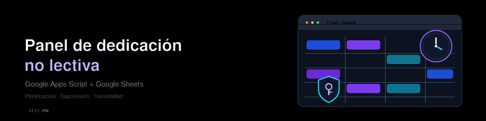
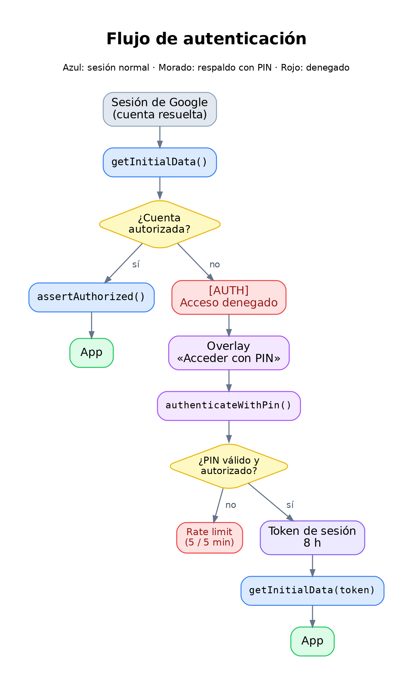
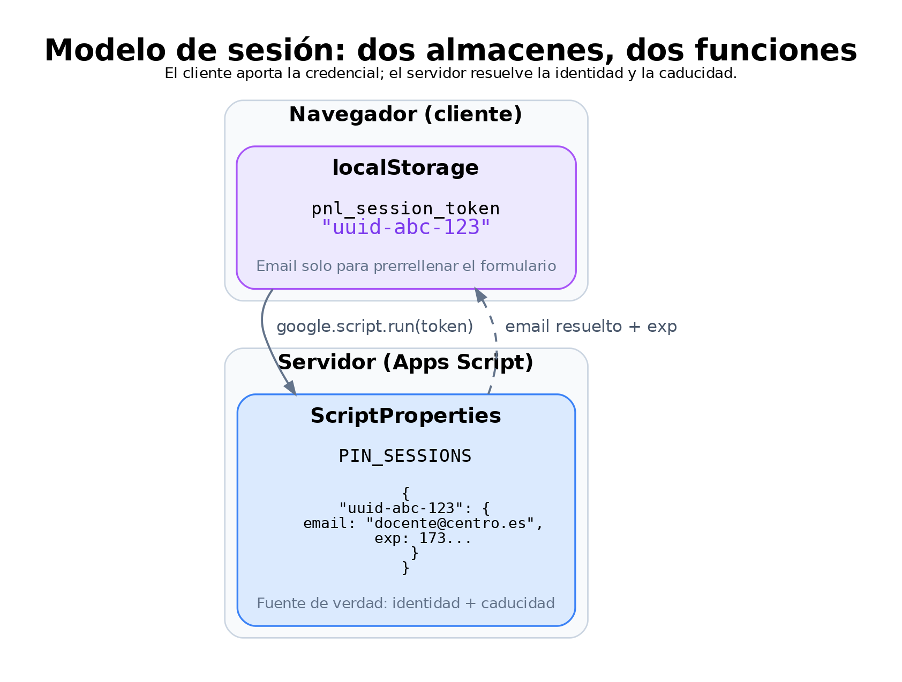

# Panel de gestión de dedicación no lectiva 📅



Aplicación web desarrollada con **Google Apps Script** y **Google Sheets** para centros educativos. Permite al profesorado planificar y consultar sus franjas horarias no lectivas (guardias, tutorías, gestión) de forma integrada con el horario lectivo, con validación en servidor, control de solapamientos y trazabilidad completa.

El repositorio contiene el **código y las herramientas de desarrollo**; no incluye la hoja de cálculo ni datos reales. La hoja no se comparte porque contiene datos del claustro y configuración específica del centro. Su estructura se documenta aquí para que otro centro pueda recrearla con datos ficticios.

## Contenido

- [Objetivo](#-objetivo)
- [El problema: multi-login de Google en Apps Script](#-el-problema-multi-login-de-google-en-apps-script)
- [La solución: acceso de respaldo con PIN](#la-solución-adoptada-pin-de-respaldo)
- [Funcionalidades](#-funcionalidades)
- [Estructura de la hoja de cálculo](#-estructura-de-la-hoja-de-cálculo)
- [Arquitectura del código](#-arquitectura-del-código)
- [Desarrollo y despliegue](#-desarrollo-y-despliegue)
- [Auditoría](#-auditoría)
- [Seguridad](#-seguridad)
- [Pruebas y verificación](#-pruebas-y-verificación)
- [Solución de problemas](#-solución-de-problemas)
- [Historial de versiones](#-historial-de-versiones)
- [Referencias](#-referencias)
- [Autor](#-autor)

## 🎯 Objetivo

Optimizar la planificación del horario no lectivo del profesorado:

- Evitar conflictos entre clases lectivas y sesiones no lectivas.
- Facilitar la supervisión por parte de jefatura de estudios.
- Asegurar que cada docente cumple sus sesiones de dedicación ajustadas.
- Dejar rastro de quién crea, modifica o elimina cada sesión.

La unidad de medida son **sesiones semanales**. Cada franja cuenta como una sesión aunque su duración real sea de 55 minutos. El tiempo solo se usa para colocar las sesiones en la rejilla y detectar solapamientos, no para contabilizar.

## 🧩 El problema: multi-login de Google en Apps Script

Esta sección documenta el problema que motivó el acceso con PIN. Es un caso real de un centro con Google Workspace y ChromeOS Flex, y probablemente el motivo por el que este repositorio puede servir a otros desarrolladores.

### Contexto

- El centro trabaja con Google Workspace. El profesorado tiene cuentas corporativas en el dominio del centro.
- La webapp se publica con:

  ```json
  "webapp": {
    "executeAs": "USER_DEPLOYING",
    "access": "DOMAIN"
  }
  ```

  Es decir, el código se ejecuta como la cuenta que despliega y solo pueden abrirla cuentas del dominio del centro.

- El desarrollador trabaja en **ChromeOS Flex**, que no permite perfiles de Chrome como Chrome de escritorio. Todas las cuentas de Google conviven en la misma sesión del navegador: la cuenta principal del centro de trabajo, varias cuentas del centro educativo y una cuenta personal.
- La app usa `Session.getActiveUser().getEmail()` para identificar a quien entra y contrasta ese email con las pestañas `Ajustes` (administradores/lectores) y `Resumen HS` (docentes).

### Síntomas

1. **La app carga con la cuenta equivocada.** Google resolvía la webapp con una cuenta del dominio distinta de la esperada (`convivencia@...` en lugar de la cuenta docente del desarrollador). Como esa cuenta sí pertenece al dominio, el control `access: DOMAIN` pasaba y la app llegaba a ejecutarse.
2. **El error lo lanzaba la propia app.** `Session.getActiveUser().getEmail()` devolvía `convivencia@...`; `assertAuthorized()` no la encontraba en `Ajustes` ni en `Resumen HS` y mostraba el diálogo de “no tienes permisos”. No era un error de carga de Google, sino de identidad.
3. **Otra webapp parecida sí cargaba, pero sin datos.** No tenía puerta de acceso propia: filtraba por el email equivocado y devolvía una vista vacía. El mismo problema, distinto síntoma.
4. **`?authuser=N` no funcionaba.** Al añadirlo a la URL, Google redirigía a `script.google.com/accounts?authuser=N&continueUrl=...` y terminaba en “No se puede abrir el archivo en estos momentos”. El índice de cuenta es ordinal y frágil: cambia al añadir o quitar cuentas.
5. **La variante de dominio con índice tampoco funcionaba.** URLs del tipo `https://script.google.com/a/macros/<dominio>/u/N/s/<id>/exec` no resolvían el problema de forma fiable.
6. **El truco de `AccountChooser` dejó de funcionar.** `google.com/accounts/AccountChooser?Email=...&continue=...` es un endpoint heredado; selecciona la cuenta en `accounts.google.com`, pero la petición final a `script.google.com` vuelve a resolver la sesión por su cuenta y el `continue` se pierde o falla.
7. **El dashboard y la webapp usaban cuentas distintas.** El dashboard de Apps Script abría con una cuenta personal, mientras que la webapp usaba `convivencia@...`. Drive sí cambiaba de cuenta correctamente con `?authuser=N`. Eso confirmaba que el problema era específico de `script.google.com` y de las webapps de Apps Script, no de la cuenta ni de los permisos del deployment.

### Por qué ocurre

Google **no soporta oficialmente multi-login en Apps Script, add-ons ni webapps**. La documentación oficial recomienda cerrar sesión de todas las cuentas o usar una ventana de incógnito. El comportamiento real es más sutil:

- `script.google.com` mantiene una cuenta “predeterminada” por contexto de servicio. Con varias cuentas abiertas, no siempre es la que el usuario cree.
- En una webapp, `doGet()` puede ejecutarse con una cuenta y las llamadas posteriores de `google.script.run` con otra. `Session.getActiveUser()` puede devolver la cuenta equivocada o una cadena vacía.
- `access: DOMAIN` solo garantiza que **alguna** cuenta del dominio pueda abrir la app; no permite elegir **cuál**.
- Las soluciones basadas en `?authuser=N` o en la ruta `/u/N/` dependen de un índice ordinal y de que el redirect de Apps Script lo respete. En la práctica no es fiable para webapps.

Referencias útiles:

- [Apps Script: Issues with multiple Google Accounts](https://developers.google.com/apps-script/guides/support/troubleshooting#issues_with_multiple_google_accounts)
- [Issue 69270374: unexpected “authorization is required” con varias cuentas](https://issuetracker.google.com/issues/69270374)
- [Issue 165350842: la URL de la webapp va mal con varias cuentas](https://issuetracker.google.com/issues/165350842)
- [Google Chrome Help: índices de cuenta y `authuser`](https://support.google.com/chrome/thread/383009127)

### Soluciones descartadas

| Solución | Por qué se descartó |
|---|---|
| Cerrar sesión de todas las cuentas y entrar solo con la corporativa | Funciona, pero es inviable en el día a día: se pierden las demás sesiones y hay que repetirlo cada vez. |
| Ventana de incógnito | Obliga a volver a autenticarse y a reconstruir el contexto. El usuario lo descartó explícitamente. |
| Cambiar de usuario en ChromeOS | Rompe el flujo de trabajo y no siempre está disponible. |
| `?authuser=N` | No se respeta de forma fiable en webapps; redirige a `/accounts` y falla. El índice cambia con el orden de cuentas. |
| Ruta `/a/macros/<dominio>/u/N/s/.../exec` | Tampoco resolvió el problema en este entorno. |
| `AccountChooser` con `continue` | Endpoint heredado, frágil y con pérdida del contexto de cuenta. |
| Incrustar la app en Google Sites o en la intranet | El iframe resuelve la misma sesión; no cambia la cuenta. |
| Compartir la hoja con la otra cuenta | El bloqueo es del deployment (`access: DOMAIN`), no de permisos de la hoja. |
| Cambiar `access` a `ANYONE` | No elige la cuenta correcta y amplía la exposición. |
| Login OAuth/GIS | Es la solución más robusta a largo plazo, pero requiere un cliente OAuth en GCP, consentimiento, intercambio de tokens y cambios en todos los endpoints. GIS dentro del iframe de `HtmlService` además choca con el origen `*.googleusercontent.com`, que Google no permite registrar como JavaScript origin. Se dejó como evolución futura. |
| Proxy con IAP, Cloud Run o un dominio propio | Excesivo para el problema y para el tamaño del proyecto. |

### La solución adoptada: PIN de respaldo

En lugar de intentar forzar a Google a usar una cuenta concreta, la app **deja de depender de `Session.getActiveUser()` cuando la identidad resuelta no es la correcta**. El flujo es:

1. La webapp carga con la cuenta que Google resuelva. Si esa cuenta está autorizada, todo funciona como siempre: el profesorado con una única cuenta corporativa no ve nada distinto.
2. Si la cuenta resuelta **no** está autorizada, la app muestra un error accionable con el botón **Acceder con PIN**.
3. El usuario introduce su email y un PIN. El backend valida el PIN contra la pestaña `Acceso PIN`, comprueba que el email está autorizado en `Ajustes` o `Resumen HS` y emite un **token de sesión de 8 horas**.
4. Todas las llamadas (`getInitialData`, `getTeacherData`, `saveSession`, `deleteSession`, `getAllNonTeachingRecords`) envían el token. El servidor resuelve la identidad desde el token y **no** desde `Session`.
5. El token se guarda en `localStorage`; el PIN nunca se guarda en el navegador. El botón **Salir** revoca el token en el servidor.

La pestaña `Acceso PIN` es la única fuente de credenciales:

| Email | PIN | Notas |
|---|---|---|
| `docente@centro.es` | `código-largo-y-aleatorio` | Admin |

- Solo el propietario de la hoja edita esta pestaña. La app únicamente lee `Email` y `PIN`; `Notas` es de uso manual.
- El PIN **no concede permisos por sí mismo**: el email debe existir además en `Ajustes!C` (administradores), `Ajustes!D` (lectores) o `Resumen HS` (docentes). La autorización sigue viviendo en las hojas de siempre.
- Para revocar: quita el email de `Ajustes` (efecto inmediato, porque `assertAuthorized` se ejecuta en cada llamada), borra su fila de `Acceso PIN` (impide nuevos accesos con PIN; las sesiones ya abiertas caducan a las 8 horas) o pulsa **Salir**.
- Para cortar todas las sesiones de golpe, borra la propiedad `PIN_SESSIONS` en *Configuración del proyecto → Propiedades de la secuencia de comandos*.

### Flujo de autenticación



<details>
<summary>Ver el flujo en texto</summary>

```text
Flujo normal (una sola cuenta corporativa)
  Google session ──> getInitialData() ──> Session.getActiveUser()
                                          └─> assertAuthorized() ──> app

Flujo con PIN (cuenta equivocada o no autorizada)
  Google session ──> getInitialData() ──> Session.getActiveUser() = otra cuenta
                                          └─> [AUTH] ──> overlay "Acceder con PIN"
                                                          └─> authenticateWithPin(email, PIN)
                                                                ├─ valida PIN contra "Acceso PIN"
                                                                ├─ assertAuthorized(email)
                                                                ├─ crea token (8 h)
                                                                └─ devuelve { token, email }
                                                          └─ getInitialData(token)
                                                                └─ PinAuth.getCurrentUserEmail(token)
                                                                      └─ assertAuthorized() ──> app
```

</details>

### Decisiones de diseño y seguridad

- **Token opaco y servidor-side.** El token es un UUID guardado en `ScriptProperties` (`PIN_SESSIONS`) con `{ email, exp }`. No contiene el email ni el PIN, y no se puede fabricar desde el cliente.
- **Caducidad de 8 horas.** Es una jornada laboral. `CacheService` solo admite 6 horas, por eso se usa `ScriptProperties`; el mapa se poda al crear o validar sesiones.
- **Rate limit.** Cinco intentos fallidos bloquean ese email durante cinco minutos. La UI muestra una cuenta atrás en vivo y la hora de restablecimiento. El bloqueo es por email; un atacante que conozca el email podría bloquearlo temporalmente, por eso el PIN debe ser largo.
- **Auditoría.** Cada intento escribe una fila en `Auditoría` con `Rol = PIN` y `Acción = LOGIN_PIN`, `LOGIN_PIN_FALLIDO`, `LOGIN_PIN_DENEGADO` o `LOGOUT`. La columna `Tipo` (G) se deja vacía porque está reservada al tipo de sesión del horario semanal.
- **Funciones internas encapsuladas.** En Apps Script **todas las funciones de nivel superior son invocables desde `google.script.run`**. Si `createSession`, `getPinSessions` o `savePinSessions` fueran globales, cualquier usuario podría llamarlas desde la consola y saltarse el PIN. Por eso viven dentro de un IIFE (`PinAuth`) y solo se exponen `authenticateWithPin` y `revokeMySession`. Esta es una lección importante para cualquier webapp de Apps Script que gestione sesiones.
- **Sin recarga tras el PIN.** El primer intento hacía `location.reload()`; en el iframe de `HtmlService` eso podía dejar el panel en blanco. Ahora el error se muestra en un overlay que no destruye el DOM y, al validar el PIN, se llama directamente a `loadInitialData()`. Hay un reintento de 500 ms por si la sesión recién creada aún no es visible.
- **Mensaje de error accionable.** Los errores de identidad llevan el prefijo interno `[AUTH]`; la UI lo interpreta y muestra el botón del PIN sin exponer detalles técnicos.

### Modelo de sesión: dos almacenes, dos funciones

El token aparece en dos sitios, pero **no es un secreto duplicado**: son las dos mitades de la misma sesión.



<details>
<summary>Ver el diagrama en texto</summary>

```text
Navegador (cliente)                         Servidor (Apps Script)
localStorage: "uuid-abc-123"  ──RPC──>  ScriptProperties:
                                          PIN_SESSIONS = {
                                            "uuid-abc-123": {
                                              email: "docente@centro.es",
                                              exp: 173...
                                            }
                                          }
```

</details>

- **`ScriptProperties`** guarda el **registro de la sesión en el servidor**: un mapa `token → { email, exp }`. Es la fuente de verdad para resolver la identidad y comprobar la caducidad. Persiste entre ejecuciones y permite una caducidad exacta de 8 horas.
- **`localStorage`** guarda solo el **identificador opaco** (el UUID) que el navegador envía en cada llamada. No guarda el email como autoridad ni, por supuesto, el PIN. El email de `pnl_pin_email` es solo para prerrellenar el formulario.

¿Por qué hacen falta los dos?

- Sin `ScriptProperties`, el servidor no podría saber a qué email pertenece el token ni revocarlo o caducarlo; el cliente podría inventarse un email y decir “soy administrador”.
- Sin `localStorage`, el cliente no sabría qué token enviar tras recargar la página o abrir otra pestaña, y habría que reintroducir el PIN en cada carga.
- El cliente aporta la **credencial**; el servidor resuelve la **identidad y la caducidad**. Es el equivalente a una cookie de sesión en el navegador más una tabla de sesiones en el servidor.

Consecuencias de seguridad:

- El token es un **bearer token**: quien lo posea puede actuar como ese usuario hasta que caduque. De ahí la caducidad de 8 h, el botón **Salir** (borra la entrada de `ScriptProperties` y el `localStorage`) y la necesidad de cuidar el XSS.
- El PIN **nunca** se guarda en el navegador; solo viaja al servidor en el momento de la validación.
- El servidor **no confía en el email que venga del cliente**: siempre lo resuelve desde el token. Editar `localStorage` no cambia la identidad.
- Se usa `ScriptProperties` y no `CacheService` porque este último tiene un máximo de 6 horas; aquí se necesitan 8 (jornada laboral).

### Limitaciones

- **No elige la cuenta de Google.** El PIN no cambia la sesión del navegador; la app sigue cargando con la cuenta que Google resuelva. Lo que hace es **ignorar esa identidad** para la sesión autenticada por PIN.
- **Necesita que la app llegue a cargar.** Si no hay ninguna cuenta del dominio en la sesión, Google muestra su propia pantalla de acceso antes de ejecutar `doGet`; el PIN no puede aparecer. Con una cuenta del dominio (aunque no sea la deseada), la app carga y el PIN funciona.
- **El PIN es un secreto compartido.** En esta implementación se guarda en claro en una pestaña restringida al propietario. Si el PIN se filtra, la cuenta asociada queda comprometida hasta que se cambie o se revoque. Usa un código largo, no lo reutilices y rótalo si la hoja se comparte o se exporta. Una mejora pendiente es guardar `Salt` + `Hash` en lugar del PIN en claro.
- **No es SSO.** Es un mecanismo de respaldo (“break-glass”) para un caso concreto de multi-login. Si el centro necesita identidad fuerte, la evolución natural es OAuth/OIDC con consentimiento interno o un proxy con IAP.
- **Equipos compartidos.** El token vive en `localStorage`; en un equipo compartido hay que pulsar **Salir** al terminar.

## ✨ Funcionalidades

### 1. Planificador semanal interactivo

- Visualización de celdas lectivas (azul) y no lectivas (púrpura/naranja/verde).
- Gestión de sesiones mediante clics: añadir, editar y eliminar con actualizaciones optimistas en la UI.
- Indicadores de estado (PENDIENTE/COMPLETO) y cálculo de metas en tiempo real.

### 2. Gestión de roles y permisos

- **Docente**: acceso a su propio horario y estadísticas personales, además de la vista global del claustro.
- **Administrador**: puede ver y modificar el horario de cualquier docente y acceder a las herramientas de supervisión. La configuración (roles, tipos de sesión y grupos) se gestiona directamente en `Ajustes`.
- **Lector**: acceso en solo lectura a la vista global.

> La vista global es visible para **todo el profesorado autorizado**: su objetivo es que el claustro sepa quién tiene guardias, tutorías o está en horario de gestión. Las observaciones de cada sesión también son visibles para el resto de docentes en los tooltips.

### 3. Supervisión de incidencias (solo administración) 🔍

- Panel que escanea en tiempo real a toda la plantilla para detectar horarios incompletos.
- Muestra las tarjetas de estadísticas de cada docente con validación pendiente.
- Acceso directo desde el informe al horario del docente para agilizar las correcciones.

### 4. Solapamientos excepcionales (solo administración) 🚨

- Permite a los administradores registrar sesiones no lectivas sobre franjas lectivas en periodos especiales (FCT, prácticas en empresa).
- Visualización mediante **pastillas divididas** que muestran ambas actividades simultáneamente.
- Confirmación de seguridad mediante modal dinámico antes de realizar la acción.

### 5. Vista global (dashboard)

- Rejilla comparativa de todo el centro para el control de coberturas.
- Filtros por docente, búsqueda por nombre y tipo de actividad (guardias, tutorías, gestión).
- Tooltips informativos con notas adicionales de cada sesión.

### 6. Trazabilidad total

- Muestra la **fecha, hora y autor de la última modificación** de cada ficha horaria.
- Auditoría automática de cada cambio en el backend.
- Auditoría específica de los accesos con PIN.

## 📊 Estructura de la hoja de cálculo

> **La hoja de cálculo no se incluye en el repositorio.** Contiene datos reales del profesorado y configuración específica del centro. Esta sección documenta su estructura para que otro centro pueda recrearla con datos ficticios. Si reutilizas el proyecto, respeta la normativa de protección de datos y no publiques la hoja.

### Convenciones generales

- Las pestañas se localizan **por nombre exacto** (`SHEET_NAMES` en `Code.gs`).
- `Resumen HS` tiene las cabeceras en la **fila 3** y los datos desde la **fila 4**. El resto de pestañas tienen cabeceras en la **fila 1** y datos desde la **fila 2**.
- Los emails se comparan sin distinguir mayúsculas/minúsculas y sin espacios laterales.
- No cambies el nombre de las pestañas ni muevas la columna J de `Resumen HS` (ver más abajo).

### `Resumen HS`

Perfiles docentes, códigos y metas.

| Columna | Contenido | Uso |
|---|---|---|
| A | Docente (nombre) | Búsqueda por cabecera `docente`/`nombre`/`profesor`; fallback a A |
| Según cabecera | Email | Cabecera que contenga `email`, `correo` o `mail` |
| Según cabecera | Código | Cabecera exacta `Código` o `Codigo`; cruza con `Clases!D` |
| J | HS no lectivas ajustadas | **Índice fijo 9**; meta de sesiones semanales |
| K | Guardias sem | Cabecera que contenga `guardias sem` |
| L | Tutoría grupo | Cabecera que contenga `tutoría grupo` |

- Las columnas B–I son propias del centro; el código no las usa.
- La meta de horas se lee de la **columna J** por índice fijo. No la muevas.
- Los docentes se ordenan alfabéticamente para el selector de administración.
- Las metas solo se envían al frontend cuando el usuario es administrador.

### `Clases (importado)`

Horario lectivo oficial del centro. Se usa para derivar franjas, clases lectivas y conteos.

| Columna | Contenido |
|---|---|
| A | Grupo |
| B | Día |
| C | Módulo |
| D | Docente (código, coincide con `Resumen HS!Código`) |
| E | Aula |
| F | Inicio (`HH:mm` o fecha/hora) |
| G | Fin (`HH:mm` o fecha/hora) |

- Una fila con módulo/docente vacío indica que ese grupo no tiene clase en esa franja; **no** implica que la franja completa sea un descanso. Una franja es descanso solo si **ningún** grupo tiene clase en ella.
- Las horas se normalizan a `HH:mm`.

### `Horario no lectivo`

Repositorio de sesiones no lectivas.

| Columna | Contenido |
|---|---|
| A | Email del docente |
| B | Día (`Lunes`…`Viernes`) |
| C | Inicio (`HH:mm`) |
| D | Fin (`HH:mm`) |
| E | Tipo de actividad (debe existir en `Ajustes!A`) |
| F | Grupo (obligatorio para tutorías) |
| G | Notas (visibles en los tooltips) |

- Clave lógica de upsert: **Email + Día + Inicio**. Guardar una sesión con la misma clave actualiza la fila; con distinto inicio crea otra.
- La eliminación busca la misma clave.
- `LockService` evita escrituras concurrentes.

### `Ajustes`

Configuración y autorización.

| Columna | Contenido | Uso |
|---|---|---|
| A | Tipo de sesión | Lista de tipos (Guardia, Tutoría, Gestión…) |
| B | Grupo | Lista de grupos |
| C | Administradores | Emails, uno por fila |
| D | Lectores | Emails, uno por fila |
| E | Logo | Solo se lee **E2**; debe ser una URL `http(s)` |

- Si `E2` está vacío o no es una URL válida, se usa el logo por defecto.
- Los tipos y grupos se leen desde la fila 2 hasta la última fila con datos.
- Esta pestaña es la **fuente de autorización**. `Acceso PIN` solo autentica.

### `Acceso PIN`

Credenciales de respaldo. **No la administra la app**; solo se edita manualmente desde la hoja.

| Columna | Contenido |
|---|---|
| A | Email |
| B | PIN (formato texto) |
| C | Notas (opcional, la app no la usa) |

- El email debe existir además en `Ajustes!C`, `Ajustes!D` o `Resumen HS`.
- Usa un código largo y alfanumérico. Si la columna se formatea como número se pueden perder ceros a la izquierda.
- En esta implementación el PIN se guarda en claro porque la hoja está restringida al propietario. Si se comparte o exporta, rótalo o migra a `Salt` + `Hash`.

### `Auditoría`

Registro histórico. Se crea automáticamente si no existe.

| Columna | Contenido |
|---|---|
| A | Timestamp |
| B | Actor (email) |
| C | Rol (`Propietario`, `Admin`, `PIN`) |
| D | Objetivo (email del docente afectado) |
| E | Acción (`CREAR`, `ACTUALIZAR`, `ELIMINAR`, `LOGIN_PIN`, `LOGIN_PIN_FALLIDO`, `LOGIN_PIN_DENEGADO`, `LOGOUT`) |
| F | Slot (p. ej. `Lunes 09:00-10:00`; vacío en accesos) |
| G | Tipo (tipo de sesión; **vacío en accesos**) |
| H | Grupo (vacío en accesos) |

- La última modificación de un docente se calcula buscando en la columna D e **ignorando** las filas de acceso (`Acción` de login/logout o `Tipo = ACCESO` en filas antiguas).
- La columna G está reservada al tipo de sesión del horario semanal. No escribas `ACCESO` ahí.

## 📐 Arquitectura del código

| Archivo | Responsabilidad |
|---|---|
| `Code.gs` | Backend: lectura/escritura de hojas, validación, autorización, PIN, sesiones, auditoría, `doGet`. |
| `index.html` | Plantilla HTML: cabecera, navegación, vistas, modales (editor, confirmación y PIN). |
| `javascript.html` | Frontend: estado, renderizado, llamadas `google.script.run`, token de sesión, modal de PIN y gestión de errores. |
| `css.html` | Pequeños estilos y animaciones. |
| `appsscript.json` | Manifiesto de Apps Script (`executeAs`, `access`, zona horaria, runtime). |
| `scripts/lint.js` | Extrae el JS de `javascript.html` y ejecuta ESLint sobre backend y frontend. |
| `.clasp.json` | `scriptId` del proyecto de Apps Script y directorio raíz. No contiene credenciales. |
| `.claspignore` | Lista blanca de archivos que se suben con `clasp push`. |
| `docs/images/` | Banner y diagramas del README; `banner.svg` y los `.dot` son las fuentes editables. |

### Endpoints públicos

Se invocan desde `google.script.run`:

- `getInitialData(sessionToken)`: perfil, configuración, estructura horaria, registros propios, clases, lista de docentes, vista global y última modificación.
- `getTeacherData(sessionToken, targetEmail)`: cambio de docente (solo administración).
- `saveSession(sessionToken, sessionData)`: alta/edición con validación y auditoría.
- `deleteSession(sessionToken, sessionData)`: borrado con auditoría.
- `getAllNonTeachingRecords(sessionToken)`: vista global.
- `authenticateWithPin(email, pin)`: validación del PIN y emisión del token.
- `revokeMySession(sessionToken)`: cierre de sesión PIN.

El resto de funciones sensibles de sesión están dentro del IIFE `PinAuth` y no son accesibles desde el cliente.

## 💻 Desarrollo y despliegue

El proyecto se gestiona con [clasp](https://github.com/google/clasp).

### Preparar un equipo nuevo

1. Instalar Node.js 20.19+ (o 22.13+/24+).
2. Clonar el repositorio e instalar dependencias: `npm ci` (o `npm install` la primera vez).
3. Autenticarse con una cuenta con permisos de edición sobre el proyecto de Apps Script: `npm run login`.

Las versiones de `clasp` y ESLint quedan fijadas por `package.json` + `package-lock.json`.

`.clasp.json` está versionado: solo contiene el `scriptId` y el directorio raíz, **no credenciales**. `clasp login` guarda el token en `~/.clasprc.json`, fuera del repositorio.

### Comandos habituales

```bash
npm run status       # muestra qué archivos se subirán
npm run push         # sube Code.gs, index.html, css.html, javascript.html y appsscript.json
npm run deployments  # lista los despliegues y sus IDs
npm run deploy -- -i <deploymentId> -d "descripción"  # publica el código actual en un despliegue existente
npm run open         # abre el proyecto en el editor de Apps Script
npm run lint         # analiza Code.gs y el JS de javascript.html con ESLint
```

> `npm run push` actualiza el código del proyecto, pero la URL `/exec` sigue sirviendo la última versión desplegada. Después de cada push hay que publicar una nueva versión con `npm run deploy -- -i <deploymentId>` o desde *Implementar → Gestionar implementaciones*.

### Indicador de versión

El panel lateral muestra, en la parte inferior izquierda, la versión del código (`APP_VERSION` en `Code.gs`) y el canal de ejecución.

- `/dev` sirve siempre el último push y solo lo abren editores del script.
- `/exec` sirve la última versión publicada.

Para que el canal sea inequívoco, añade el parámetro a tus marcadores:

- Desarrollo: `.../dev?canal=dev`
- Producción: `.../exec?canal=prod`

Si no se indica el parámetro, se intenta deducir del referrer. Recuerda subir `APP_VERSION` cada vez que publiques cambios.

### Lint

`npm run lint` copia `Code.gs` a `.tmp/`, extrae el bloque `<script>` de `javascript.html` y ejecuta ESLint con los globals de navegador y de Apps Script. No modifica el código ni se sube a Apps Script; `.tmp/` está en `.gitignore`.

### Embebido y X-Frame-Options

La webapp se sirve con `XFrameOptionsMode.ALLOWALL` para permitir incrustarla en otra página, por ejemplo la intranet del centro. Esto también permite que cualquier web la embeba, con el consiguiente riesgo de clickjacking; se asume de forma consciente porque el uso previsto puede requerir el embebido. Si deja de ser necesario, cambia a `HtmlService.XFrameOptionsMode.DEFAULT`.

## 🔍 Auditoría

La pestaña `Auditoría` registra:

- **Cambios de horario**: `CREAR`, `ACTUALIZAR`, `ELIMINAR`, con actor, objetivo, slot, tipo y grupo.
- **Accesos con PIN**: `LOGIN_PIN`, `LOGIN_PIN_FALLIDO`, `LOGIN_PIN_DENEGADO`, `LOGOUT`, con `Rol = PIN` y `Tipo` vacío.

La UI muestra la última modificación real de cada docente. Para calcularla se ignora cualquier fila de acceso, de modo que un login no aparece como “última modificación”.

## 🔐 Seguridad

- **Primera barrera: `access: DOMAIN`.** Solo cuentas del dominio pueden cargar la webapp. El PIN es un respaldo para cuando Google resuelve una cuenta del dominio distinta de la deseada.
- **Autorización separada de autenticación.** El PIN no concede rol: el email debe estar en `Ajustes`/`Resumen HS`. La autorización se comprueba en cada llamada con `assertAuthorized`.
- **Token opaco de 8 h.** UUID en `ScriptProperties`; caduca y se puede revocar. No se guarda el PIN en el navegador.
- **Rate limit.** 5 intentos → 5 minutos por email. Con un PIN largo el riesgo de fuerza bruta es bajo; el bloqueo protege sobre todo frente a errores y ataques oportunistas.
- **Auditoría de accesos.** Cada intento queda registrado con el email y la acción.
- **Funciones internas encapsuladas.** Evita que un cliente llame a `createSession`, `getPinSessions` o `savePinSessions` desde `google.script.run`. Es imprescindible en cualquier webapp de Apps Script con sesiones propias.
- **Escapado de datos.** Los nombres, grupos y notas se escapan antes de insertarlos en HTML (`escapeHtml`). El token vive en `localStorage`; si se detecta un XSS, hay que revocarlo.
- **Revocación.** Quitar el email de `Ajustes` corta el acceso en la siguiente llamada. Borrar la fila de `Acceso PIN` impide nuevos logins; las sesiones abiertas caducan a las 8 h. `Salir` revoca la sesión actual.

## 🧪 Pruebas y verificación

- `npm run lint` debe terminar con 0 errores.
- Prueba manual recomendada:
  1. Entrar con una cuenta autorizada: la app debe cargar sin PIN.
  2. Entrar con una cuenta del dominio no autorizada: debe aparecer el overlay con **Acceder con PIN**.
  3. Validar el PIN: el panel debe renderizarse sin recargar la página.
  4. Comprobar `Auditoría`: fila con `Rol = PIN`, `Acción = LOGIN_PIN` y columna G vacía.
  5. Fallar el PIN 5 veces: bloqueo de 5 minutos con cuenta atrás.
  6. Pulsar **Salir**: el token se revoca y vuelve el overlay de acceso.
  7. Entrar con un docente normal: debe ver su horario y no pedir PIN.

## 🔧 Solución de problemas

| Síntoma | Causa probable | Solución |
|---|---|---|
| `clasp push` falla con `invalid_grant` / `invalid_rapt` | Token de `clasp` caducado o cuenta que exige reautenticación | `npm run login` con la cuenta propietaria y volver a hacer push |
| `/exec` sigue mostrando la versión anterior | No se ha publicado una nueva versión | `npm run deploy -- -i <deploymentId> -d "..."` y recarga forzada |
| No aparece el botón “Acceder con PIN” | La app no carga (no hay cuenta del dominio) o el error no es `[AUTH]` | Añade una cuenta del dominio; revisa el mensaje de error |
| El PIN se rechaza | Pestaña o cabeceras incorrectas, email no autorizado o PIN mal escrito | Revisa `Acceso PIN`, `Ajustes`/`Resumen HS` y el formato texto del PIN |
| Bloqueo de PIN | 5 fallos en 5 minutos | Espera a que termine la cuenta atrás |
| El panel queda en blanco | Versión antigua con recarga tras el PIN o error de renderizado | Actualiza a v1.1.1 o superior; el overlay de error muestra la causa |
| Se quiere cortar todas las sesiones PIN | Tokens activos en `PIN_SESSIONS` | Borra la propiedad `PIN_SESSIONS` en *Configuración del proyecto → Propiedades de la secuencia de comandos* |

## 📌 Historial de versiones

- **v1.0.0** — Primera versión estable: planificador, roles, supervisión y auditoría.
- **v1.1.0** — Acceso de respaldo con PIN para el problema de multi-login de Google: pestaña `Acceso PIN`, token de 8 h, rate limit, auditoría de accesos y modal de entrada.
- **v1.1.1** — Ajustes: la columna `Tipo` de `Auditoría` queda vacía en los accesos, más aire en los inputs del PIN, eliminación de la recarga tras el login (overlay no destructivo, reintento de carga y `try/catch` de renderizado).

## 📚 Referencias

- [Apps Script: Troubleshooting — Issues with multiple Google Accounts](https://developers.google.com/apps-script/guides/support/troubleshooting#issues_with_multiple_google_accounts)
- [Issues with multiple accounts (Script Examples)](https://sites.google.com/site/scriptsexamples/home/announcements/multiple-accounts-issue-with-google-apps-script)
- [Issue 69270374](https://issuetracker.google.com/issues/69270374)
- [Issue 165350842](https://issuetracker.google.com/issues/165350842)
- [clasp](https://github.com/google/clasp)
- [Google Identity Services](https://developers.google.com/identity/gsi/web) — evolución recomendada si se necesita SSO.

## 👤 Autor

**Pablo Felip Monferrer**

---

*Desarrollado para la gestión eficiente de centros educativos. El código se comparte como referencia; la hoja de cálculo y los datos reales no forman parte del repositorio.*
